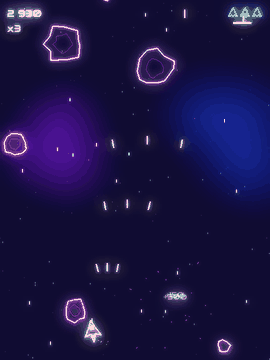

# Astro Blaster

Un shoot'em up néon écrit en Python avec [pygame-ce](https://pyga.me) : un vaisseau, des pluies de météorites, un vaisseau-mère en trois phases. Tout est dessiné et synthétisé en code : aucune image, aucun fichier son.



## Le jeu

- **Flèches** pour se déplacer, **Espace** pour tirer (touche maintenue).
- La difficulté monte en continu : quelques petites météorites au début, puis des grosses qui se brisent en morceaux, des trajectoires en zigzag et des rafales.
- Trois bonus tombent des météorites détruites : **tir triple** (jaune), **bouclier** (vert), **bombe** (orange, nettoie l'écran).
- Au bout de 2 min 30 : alerte, puis **le vaisseau-mère**. Seul son cœur est vulnérable. Phase 1 en éventails, phase 2 en spirales avec deux tourelles, phase 3 en rage avec un laser balayant annoncé par un trait d'avertissement.
- Chaque boss vaincu rapporte une vie (5 au maximum) et lance un nouveau cycle, plus dur.
- Le combo (jusqu'à ×5) récompense les séries sans perdre de vie (le bouclier le protège). Le record est sauvegardé.

| Touche | Action |
|---|---|
| Flèches | se déplacer |
| Espace | tirer |
| P ou Échap | pause |
| M | couper le son |
| F11 | plein écran |
| F3 | images par seconde |

## Démarrage

Il faut [uv](https://docs.astral.sh/uv/), le gestionnaire de projets Python. Il installe lui-même la bonne version de Python.

```bash
git clone https://github.com/TeeBo8/astro-blaster.git
cd astro-blaster
uv run astro-blaster          # lance le jeu
uv run astro-blaster --boss   # commence juste avant le boss
```

## Stack

| Rôle | Outil |
|---|---|
| Langage | Python 3.13 |
| Moteur de jeu | pygame-ce (version communautaire de pygame) |
| Projet et dépendances | uv |
| Lint et formatage | Ruff |
| Tests | pytest |
| Version navigateur | pygbag (Python compilé en WebAssembly) |

## Organisation du code

```
src/astro_blaster/
  config.py        tous les réglages : vitesses, couleurs, difficulté, boss, son
  game.py          boucle principale (async, pour le navigateur)
  director.py      déroulé de la partie : météorites → alerte → boss → cycle suivant
  difficulty.py    courbe de difficulté
  scoring.py       score et combo
  storage.py       record dans un fichier (ordinateur) ou le localStorage (navigateur)
  geometry.py      collisions et petites fonctions mathématiques
  entities/        vaisseau, tirs, météorites, bonus, boss
  scenes/          écran titre, partie, combat de boss, game over
  fx/              néon et halo, fond étoilé, particules, impacts, synthétiseur, son
  assets/fonts/    police Audiowide
tests/             tests de la logique (sans affichage)
web/main.py        point d'entrée de la version navigateur
scripts/           construction de la version navigateur
```

La logique pure (difficulté, score, collisions, phases du boss, synthèse audio) ne dépend pas de l'affichage : pytest la teste sans ouvrir de fenêtre.

## Pour changer…

| Je veux changer | Fichier |
|---|---|
| la difficulté, les vitesses, la vie du boss, les couleurs | `src/astro_blaster/config.py` |
| les attaques du boss | `src/astro_blaster/entities/boss.py` |
| les sons ou la musique | `src/astro_blaster/fx/synth.py` |
| l'intensité du halo néon | `BLOOM_PASSES` dans `config.py` |
| l'enchaînement météorites / boss | `src/astro_blaster/director.py` |

## Commandes

```bash
uv run astro-blaster                  # jouer
uv run pytest                         # tests
uv run ruff check                     # lint
uv run ruff format                    # formatage
uv run python scripts/build_web.py    # version navigateur sur http://localhost:8000
uv run python scripts/build_web.py --build   # construit seulement (build/web-src/build/web)
```

## Quelques choix techniques

- **Halo néon (bloom)** : l'image est réduite, floutée avec un flou « boîte » répété, ré-agrandie puis ajoutée par-dessus. Environ 2 ms par image, contre 11 ms avec un flou gaussien en pleine taille.
- **Son 100 % synthétisé** : ondes carrées, dents de scie, bruit filtré et enveloppes, calculés au lancement. La musique synthwave est une boucle de 8 mesures, et chaque note différente n'est calculée qu'une fois.
- **Indépendant de la vitesse de la machine** : tous les mouvements sont multipliés par le temps écoulé depuis l'image précédente.
- **Ressenti** : tremblement d'écran proportionnel au carré du « traumatisme », micro-pause sur les gros impacts, ralenti à la mort du boss.

## Crédits

- Police [Audiowide](https://fonts.google.com/specimen/Audiowide) de Brian J. Bonislawsky (Astigmatic), sous licence SIL Open Font License 1.1 (`src/astro_blaster/assets/fonts/OFL.txt`).
- Tout le reste (graphismes, sons, musique) est généré par le code du projet.

## Licence

Le code est sous licence [MIT](LICENSE) : vous pouvez le réutiliser, le modifier et le redistribuer librement, en gardant la mention de copyright. La police Audiowide garde sa propre licence (OFL, voir plus haut).

Projet de [TeeBo Studio](https://teebostudio.fr).
